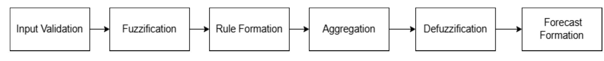

---
# ---------------------------------------------------------------------------
# REAL published paper, converted to the paper.md format. See README.md.
# M. Stelmashenko, A. Deveciogullari. Software development cost prediction method.
# Adaptive Systems of Automatic Control, 2026, No. 1 (48), pp. 3-10.
# DOI 10.20535/1560-8956.48.2026.351874 (CC BY-NC-SA 4.0).
# Every value comes from the published PDF or the journal's article page.
# Fields the journal does not publish are TODO (the template's own convention).
# ---------------------------------------------------------------------------
language: en
article_type: original
udc: "004.415"
year: 2026
issue: "№ 1 (48)"

title_en: "Software development cost prediction method"
title_uk: "Метод прогнозування вартості розробки програмного забезпечення"

authors:
  - surname_en: Stelmashenko
    name_en: "M."            # only the initial is published
    surname_uk: Стельмашенко
    name_uk: "М."
    position_en: "National Technical University of Ukraine “Igor Sikorsky Kyiv Polytechnic Institute”"
    position_uk: "Національний технічний університет України «Київський політехнічний інститут імені Ігоря Сікорського»"
    orcid: "0009-0008-8948-3358"
  - surname_en: Deveciogullari
    name_en: "A."
    surname_uk: Деведжіогуллари
    name_uk: "А."
    position_en: "National Technical University of Ukraine “Igor Sikorsky Kyiv Polytechnic Institute”"
    position_uk: "Національний технічний університет України «Київський політехнічний інститут імені Ігоря Сікорського»"
    orcid: "0000-0003-2342-8475"

# English abstract: the PDF text, one unstructured paragraph (122 words).
abstract_en: >-
  The task of accurate software development cost estimation is especially relevant in the context of a
  dynamic IT market and growing demand for effective project management. Traditional methods often lack
  flexibility and are labor-intensive, especially at early stages marked by high uncertainty. This article
  presents a software cost prediction method based on fuzzy logic, which accounts for uncertainty in input
  parameters, expert judgments, and domain-specific features without requiring strict mathematical
  formalization. The proposed model performs a full cycle of fuzzy inference, resulting in an interpretable
  interval forecast. Experimental evaluation shows that the method produces realistic estimates with
  error-aware intervals, supporting budget planning, risk assessment, and informed decision-making in IT
  project management.
# Ukrainian abstract: as shown on the journal's article page.
abstract_uk: >-
  Об’єктом дослідження є процес оцінювання вартості розробки програмного забезпечення на ранніх етапах
  життєвого циклу ІТ-проєктів. У статті проаналізовано існуючі підходи до прогнозування вартості та
  визначено їх обмеження в умовах високої невизначеності та складності проєктів. Метою роботи є підвищення
  точності та практичної корисності оцінки вартості розробки ПЗ. Для досягнення цієї мети запропоновано
  метод прогнозування вартості, який базується на методі нечіткої логіки. Зазначений підхід дозволяє
  враховувати невизначеність вхідних даних, експертні оцінки та особливості предметної області без потреби
  в точному математичному описі залежностей. Реалізовано повний цикл нечіткого виводу від перевірки вхідних
  параметрів до побудови інтервального прогнозу, що дає змогу уникнути хибної точності результату й
  забезпечити його практичну інтерпретованість для планування бюджету та ухвалення управлінських рішень.

keywords_en: [software cost estimation, fuzzy logic, decision support, uncertainty, project management, interval forecasting]
keywords_uk: [TODO]   # the journal publishes only the English keywords for this paper

# Reference list exactly as printed (DSTU-like, "//" form, with "application date").
references:
  - "Chawla R., Ahlawat D., Kumar M. Software Development Effort Estimation Techniques: A Review // International Journal of Electronics Communication and Computer Engineering. – 2014. – Vol. 5, No. 5. – P. 1166–1170. – URL: https://www.researchgate.net/publication/272073337_Software_Development_Effort_Estimation_Techniques_A_Review (application date: 05.05.2025)."
  - "Javdani Gandomani T., Koh T. W., Binhamid A. A case study research on software cost estimation using experts' estimates, Wideband Delphi, and Planning Poker technique // International Journal of Software Engineering and its Applications. – 2014. – Vol. 8, No. 11. – P. 173–182. – URL: https://www.researchgate.net/publication/269113113_A_Case_Study_Research_on_Software_Cost_Estimation_Using_Experts'_Estimates_Wideband_Delphi_and_Planning_Poker_Technique (application date: 18.05.2025)."
  - "Butt S., Misra S., Piñeres-Espitia G., Ariza P., Sharma M. M. A cost estimating method for agile software development // Computational Science and Its Applications – ICCSA 2021. – Lecture Notes in Computer Science. – 2021. – P. 231–245. – DOI: 10.1007/978-3-030-87007-2_17. – URL: https://www.researchgate.net/publication/354519035_A_Cost_Estimating_Method_for_Agile_Software_Development (application date: 18.05.2025)."
  - "Saatchi R. Fuzzy Logic Concepts, Developments and Implementation // Information. – 2024. – Vol. 15, No. 10. – P. 656. – URL: https://www.mdpi.com/2078-2489/15/10/656 (application date: 24.05.2025)."
  - "Fuzzy Logic | Introduction. – URL: https://www.geeksforgeeks.org/fuzzy-logic-introduction (application date: 27.05.2025)."
  - "Mazraeh A. Week 4: Fuzzy Inference Systems (FIS). – URL: https://medium.com/@adnan.mazraeh1993/week-4-fuzzy-inference-systems-fis-ab7758d80800 (application date: 27.05.2025)."
  - "Система нечіткого виведення. – URL: https://uk.wikipedia.org/wiki/Система_нечіткого_виведення (application date: 01.06.2025)."
  - "Moløkken K., Jørgensen M. A review of surveys on software effort estimation // Simula Research Laboratory. – 2003. – URL: https://citeseerx.ist.psu.edu/document?repid=rep1&type=pdf&doi=df1c5fb85025256a4409fe6c718ac2355b5fbb07 (application date: 03.06.2025)."
---

# Introduction

Estimating the cost of software development is a critically important stage in the life cycle of IT projects, significantly influencing the effectiveness of planning, budgeting, and resource management. However, forecasting development costs remains a challenging task due to the large number of variables, high uncertainty in the early stages of a project, the diversity of software system types, and development methodologies. Errors during the estimation phase can lead to budget overruns, missed deadlines, or reduced quality of the final product. Traditional estimation approaches, such as expert-based methods or formal models, are often insufficiently accurate or unable to account for all relevant factors. Moreover, the estimation process requires deep analysis of requirements, understanding of the domain specifics, and adaptation to the rapidly changing development environment, which complicates its standardization.

The relevance of this topic is driven by the need to simplify the software cost estimation process while maintaining the validity and practical applicability of the results. This is particularly important in the context of a highly dynamic project environment and the growing number of IT projects with strict time and budget constraints.

# Literature review and problem statement

Currently, there are several approaches to estimating the cost of software development, which are generally categorized into analytical, expert-based, and empirical methods. Among the most well-known analytical models are COCOMO (Constructive Cost Model), Putnam’s model (SLIM), Function Point Analysis (FPA), as well as approaches based on estimating module complexity, lines of code, or task effort. These methods rely on formalized calculations that take into account project parameters such as functionality scope, technology stack, team experience, and other characteristics [1].

Expert-based methods, such as Delphi and Wideband Delphi, remain popular for software cost estimation, especially when quantitative data is limited. These approaches involve experienced specialists who form forecasts based on their professional knowledge and intuition. While expert assessments can be useful, particularly in small and medium-sized projects, their accuracy heavily depends on the context—the experience of a specific team, project complexity, internal processes, and organizational culture. As a result, such estimates are typically effective only within the organization where the expert works and often prove unsuitable for transfer to other environments or project settings, making them vulnerable to subjective bias [2]. On the other hand, empirical methods that rely on historical data from completed projects have the potential to improve accuracy, but require a large database of well structured data, which is not always available in companies, especially small and medium-sized businesses.

Although there is a wide variety of estimation approaches, most of them face similar challenges. Many models are not well-suited to modern development methodologies like Agile, where estimation typically occurs at the level of iterations or sprints. Additionally, these approaches often overlook critical factors such as uncertain requirements, frequent changes to technical specifications, and the influence of external dependencies. Moreover, the process of building and using these models usually demands significant amounts of initial data and involves complex configuration, making them difficult to implement as quick, easy, and accessible tools for a broad range of users [3].

As a result, despite the availability of numerous methods, the problem of accurate cost estimation remains highly relevant. Existing approaches are often too complex and resource-intensive, lack the flexibility needed to accommodate today’s fast-paced development environments, rely heavily on human expertise, and are constrained by the limited access to historical data, especially for smaller organizations. These limitations emphasize the need for new solutions that can streamline the estimation process while maintaining practical accuracy and adaptability to real project conditions. This research is grounded in the recognition that there is still no universal, simple, and widely usable cost estimation method that can be applied in the early stages of project design with minimal input data.

# Mathematical Method for Forecasting Development Cost Based on Fuzzy Logic

The fuzzy logic method is an effective tool for modeling complex systems with uncertainty and fuzzy input data. It allows formalizing expert knowledge in the form of fuzzy rules, which provides a more flexible and accurate approach to forecasting. In the context of estimating the cost of developing a software product, the use of fuzzy logic allows to take into account subjective factors and a limited amount of input information without the need for extensive historical data [4].

The model for forecasting the cost of software product development can be represented as a modular approach, where each stage implements a separate functionality within a single fuzzy inference process. Such a structure provides both flexibility and transparency in building decision-making logic, which makes it easy to scale or adapt the system to the specific needs of the project. The sequence of the main blocks of the model can be seen at Fig. 1.

{width=15cm}

For a deeper understanding of the model structure, let's look at the functioning of each of its modules separately.

1\. Input validation is a module responsible for a comprehensive check of the correctness and completeness of the initial parameters. It monitors the availability of all necessary values, compliance of data types with expected formats, and checks whether the parameters are within the acceptable ranges. This ensures the reliability of subsequent calculations and prevents errors caused by incorrect or incomplete data.

2\. Fuzzification is a module that transforms precise numerical input values into fuzzy sets using special membership functions. This process allows information to be represented as degrees of membership to various fuzzy categories, forming the foundation for the application of fuzzy logic. Typical membership functions may include [4][5]:

- Singleton. This membership function has a value of 1 at only a single point, fully representing a crisp value in a fuzzy context.

$$ \mu(x) = \begin{cases} 1, & x = x_0 \\ 0, & x \neq x_0 \end{cases} $$

- Triangular. Used to model simple linear increases and decreases in the degree of membership. It is defined by three points: $a$ – the start, $b$ – the peak, $c$ – the end.

$$ \mu(x) = \max\left(\min\left(\frac{x-a}{b-a}, 1, \frac{c-x}{c-b}\right), 0\right) $$

- Gaussian. Provides a smooth, symmetrical distribution of membership degrees and is often used in more complex or adaptive systems. It is defined by the mean value $b$ and the standard deviation $a$.

$$ \mu(x) = e^{-0.5\left(\frac{x-b}{a}\right)^{2}} $$

3\. Rule Formation is a module responsible for developing and applying a set of logical constructs that formalize the relationships between fuzzy variables. These rules define how input fuzzy sets are combined to derive conclusions, reflecting expert knowledge and domain-specific patterns.

4\. Aggregation is a module that combines the results of all activated rules into a single output fuzzy set. This process generalizes partial evaluations, forming a complex fuzzy answer that reflects a set of logical relationships. There are two most commonly used aggregation methods [4][6]:

- Mamdani Method. The resulting fuzzy set is determined as the maximum over all rules of the minimums between the membership degrees of the input variables and the corresponding output set [7].
- Sugeno Method. The precise output value is calculated as the weighted average of the rule outputs, where the weights are the degrees of activation of each rule [7].

5\. Defuzzification is a module that transforms the fuzzy output set into a precise numerical value that can be used in further analysis. Various defuzzification methods are applied to produce the most appropriate and clearly interpretable number. These include methods such as the centroid, bisector, middle of maximum, largest of maximum, and smallest of maximum. The most common and widely used method is the centroid method, which determines the center of the area under the aggregated fuzzy set. Formally, the output value y for a continuous fuzzy set is calculated using the following formula [4]:

$$ y = \frac{\sum_i \mu(x_i)\, x_i}{\sum_i \mu(x_i)} $$

6\. Forecast Formation is the module responsible for interpreting the numerical result obtained after the defuzzification stage as a specific estimate of the software product development cost, given the defined input parameters and problem conditions. This numerical result is not treated as an absolute value but is instead converted into a range of possible values, reflecting the inherent uncertainty and variability of project execution conditions typical in software development. To avoid creating a false impression of excessive precision, the numerical result obtained after defuzzification is preliminarily rounded to a value that is more user-friendly and easier to interpret. This approach allows the user to better grasp the scale of the projected costs without perceiving the model as overly precise, since high granularity is not appropriate in the context of development uncertainty. In software cost estimation practice, it is common to present results in the form of intervals, which makes it possible to account for uncertainty and the risks associated with development. These intervals are typically based on a percentage margin of error, usually within ±30-40% of the nominal value [8]. This approach takes into account both the precision of the method and the real risks related to changing requirements, team composition, technologies, and other factors. Thus, the numerical result obtained after fuzzy inference is transformed into a range of “minimum - maximum”, which facilitates its practical application for budget planning, risk assessment, and management decision-making.

The proposed model ensures flexibility and transparency in estimating the value without the need for large amounts of data. Its modular structure allows for adaptation of forecasts to different conditions, which increases the accuracy and reliability of the results.

# Experimental Study

To practically confirm the effectiveness of the proposed modular fuzzy logic model, an experimental study was conducted. As part of this study, a specific set of input parameters characterizing a particular project was selected. Then, a step-by-step fuzzy inference process was demonstrated, in which each module operated on the selected data using the appropriate formulas.

The following parameters were selected as input data:

1. Task complexity - 7.5 (on a scale of 0 to 10)
2. Estimated number of hours - 120
3. Risk level - 6 (on a scale of 0 to 10)

The first step is input data validation, which involves checking the availability of all the necessary parameters, their correctness and compliance with the established limits of acceptable values. In this experimental study, the input data were pre-checked, so no inconsistencies or errors were detected at this stage.

The next stage is the fuzzification process, where input values must be transformed into fuzzy sets using a triangular membership function. Let us consider an example of calculating the degree of membership for the risk level parameter with a value of $x = 6$. Suppose the parameters of the triangular function for the fuzzy set "medium risk" are: $a = 4$, $b = 6$, $c = 8$. Then, the value of the membership function is calculated using the following formula:

$$ \mu(6) = \max\left(\min\left(\frac{6-4}{6-4}, 1, \frac{8-6}{8-6}\right), 0\right) = \max(\min(1, 1), 0) = 1 $$

Thus, the risk degree with a value of 6 belongs entirely to the fuzzy set "medium risk". Further, the phasing for is similarly performed for the parameters of complexity and workload.

Next, it is necessary to define fuzzy logic rules that represent the relationships between the input parameters and the output cost estimate. As an example, consider the following rule: "If the complexity is high, the workload is large, and the risk level is medium, then the development cost is high." These rules are constructed using fuzzy sets and combined using logical operations minimum (AND) and maximum (OR) to obtain a generalized result.

For the aggregation stage, we used the Mamdani method, which combines the results of the activated rules into a single fuzzy set. Taking into account the degrees of membership of the rules $\mu_1 = 0.6$ and $\mu_2 = 0.8$ and the corresponding fuzzy sets with membership functions $\mu_{c1}(z) = 0.7$ and $\mu_{c2}(z) = 0.5$, the aggregation is performed according to formula:

$$ C'_1(z) = \min(\mu_1, \mu_{c1}(z)) = \min(0.6, 0.7) = 0.6 $$

$$ C'_2(z) = \min(\mu_2, \mu_{c2}(z)) = \min(0.8, 0.5) = 0.5 $$

The processed fuzzy sets are combined using the maximum operation as follows:

$$ \mu_{\Sigma}(z) = \max(C'_1(z), C'_2(z)) = \max(0.6, 0.5) = 0.6 $$

The next stage is defuzzification, where the fuzzy set result is transformed into a single, precise numerical value. As an example, we will apply the centroid method. Let’s assume that in our case, the value y (the approximate cost of the project in dollars) can take the following discrete values: $x_1 = 5000$; $x_2 = 15000$; $x_3 = 25000$; $x_4 = 35000$; $x_5 = 45000$. Each of these values is associated with a corresponding degree of membership $\mu(x_i)$: $\mu(x_1) = 0.3$; $\mu(x_2) = 0.5$; $\mu(x_3) = 0.7$; $\mu(x_4) = 0.4$; $\mu(x_5) = 0.2$.

Now the defuzzified value can be calculated using the centroid formula:

$$ y = \frac{\sum_i \mu(x_i)\, x_i}{\sum_i \mu(x_i)} $$

Substituting the values results in the following formula:

$$ y = \frac{5000 \cdot 0.3 + 15000 \cdot 0.5 + 25000 \cdot 0.7 + 35000 \cdot 0.4 + 45000 \cdot 0.2}{0.3 + 0.5 + 0.7 + 0.4 + 0.2} = \frac{49500}{2.1} \approx 23571.4286 $$

Thus, the estimated project cost according to the centroid method is 23,571 dollars.

The final stage is the forecast formation process. At this stage, the numerical value obtained after defuzzification must be converted into a range of possible values that reflects inherent uncertainty and potential requirement changes. To achieve this, the obtained value is first rounded to the nearest thousand. That is, after rounding, the value becomes 24,000, based on which the allowable range must be formed. For this purpose, an interval is created around the obtained numerical value, taking into account a typical percentage of error. As noted in the model description, in software cost estimation practice, this indicator usually ranges between ±30-40%. In the present example, considering a 30% error margin, the lower bound of the range equals:

$$ y_{min} = 24000 \cdot (1 - 0.3) = 16800 $$

Upper bound:

$$ y_{max} = 24000 \cdot (1 + 0.3) = 31200 $$

Therefore, the final estimate of the development cost is presented as a range from 16800 to 31200 dollars. This approach ensures that possible fluctuations and risks inherent in the software development process are taken into account, which makes the forecast more flexible and practical for use in budget planning and project risk management.

# Conclusion

In the current conditions of a highly dynamic information technology market and increasing demand for effective IT project management, the issue of accurate and well-founded software development cost estimation becomes especially relevant. Considering the complexity of the process, the multifactorial influences, and the high uncertainty at early stages of the lifecycle, traditional methods often prove to be insufficiently flexible or labor-intensive.

This paper proposes a model for estimating the cost of software development based on the fuzzy logic method. This approach allows accounting for uncertainty in input data, expert opinions and specifics of the subject area without the need for a formal mathematical description of complex dependencies. The model implements a full cycle of fuzzy inference - from validating input parameters to building an interval cost forecast, which increases its practical applicability for use in real-world IT projects.

The experiments demonstrated the ability of the model to generate a realistic numerical result with its subsequent interpretation as a cost interval, taking into account the typical error of estimation. This approach reduces the risk of over-precision, which in conditions of uncertainty can mislead the customer or project management. The result is easy to understand and can be directly used for budget planning, risk management, and management decision-making.
