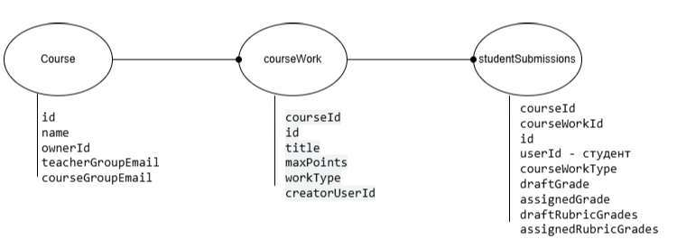
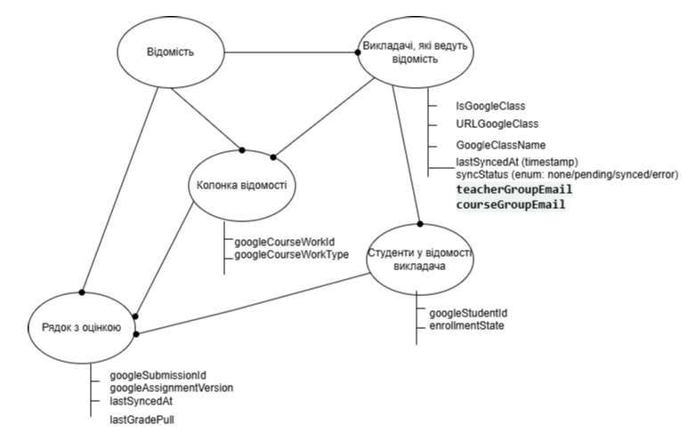
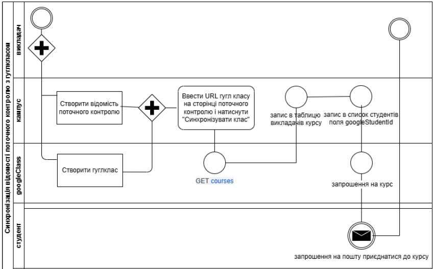
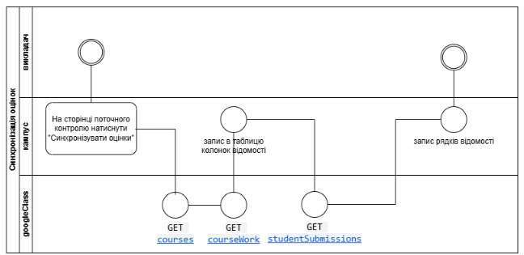

---
# ---------------------------------------------------------------------------
# REAL published paper, converted to the paper.md format. See README.md.
# К. Мамедова, А. Губський, В. Березін, О. Величко. Інтеграційне рішення експорту даних
# Google Classroom у модуль поточного контролю ІАС «Електронний кампус НТУУ «КПІ».
# Адаптивні системи автоматичного управління, 2026, № 2 (49), с. 79-84.
# DOI 10.20535/1560-8956.49.2026.369473 (CC BY-NC-SA 4.0).
# Every value comes from the published PDF or the journal's article page.
# Fields the journal does not publish are TODO (the template's own convention).
# ---------------------------------------------------------------------------
language: uk
article_type: original
udc: "004.657"
year: 2026
issue: "№ 2 (49)"

title_uk: "Інтеграційне рішення експорту даних Google Classroom у модуль поточного контролю ІАС «Електронний кампус НТУУ «КПІ»"
title_en: "TODO"   # no English title is published for this paper

authors:
  - surname_uk: Мамедова
    name_uk: "К."            # only the initial is published
    surname_en: TODO
    name_en: TODO
    position_uk: "Національний технічний університет України «Київський політехнічний інститут імені Ігоря Сікорського»"
    position_en: TODO
    orcid: "0000-0002-0666-5009"
  - surname_uk: Губський
    name_uk: "А."
    surname_en: TODO
    name_en: TODO
    position_uk: "Національний технічний університет України «Київський політехнічний інститут імені Ігоря Сікорського»"
    position_en: TODO
    orcid: "0000-0002-5361-5485"
  - surname_uk: Березін
    name_uk: "В."
    surname_en: TODO
    name_en: TODO
    position_uk: "Національний технічний університет України «Київський політехнічний інститут імені Ігоря Сікорського»"
    position_en: TODO
    orcid: "0009-0007-0050-7476"
  - surname_uk: Величко
    name_uk: "О."
    surname_en: TODO
    name_en: TODO
    position_uk: "Національний технічний університет України «Київський політехнічний інститут імені Ігоря Сікорського»"
    position_en: TODO
    orcid: "0009-0006-7894-4038"

# The abstract printed under the title in the PDF (two sentences).
abstract_top: "Стаття присвячена вирішенню проблеми імпорту даних з простору Google Classroom в модуль поточного контролю системи «Електронний кампус». Мета статті – описати етапи, з яких складається інтеграція та запропонувати програмний модуль інтеграції, що забезпечує цілісність даних та відповідність структури цифрового освітнього середовища потребам закладу вищої освіти."
# The (different, longer) abstract shown on the journal's article page, as one paragraph.
abstract_uk: >-
  Об’єктом дослідження є процеси інтеграції даних між зовнішніми освітніми платформами та внутрішніми
  системами закладу вищої освіти. У статті проаналізовано архітектуру Google Classroom API та розроблено
  алгоритми для автоматизованого експорту структурованих даних про успішність. Запропоновано модель
  інтеграційного шлюзу, що базується на протоколі OAuth 2.0, методах десеріалізації об’єктів та
  синхронізації ідентифікаторів користувачів. Метою роботи є автоматизація імпорту даних із Google
  Classroom до модуля поточного контролю системи «Електронний кампус». Для досягнення мети розроблено
  програмний модуль, який забезпечує цілісність даних та відповідність структури цифрового середовища
  потребам університету.
abstract_en: "TODO"   # no English abstract is published for this paper

keywords_uk: [Google Classroom API, OAuth 2.0, мапінг (зіставлення) даних, електронний кампус]
keywords_en: [TODO]

# The three references exactly as printed (no DSTU 8302:2015 form; each has a DOI).
references:
  - "Pooja Pafhania, Dr.Adit Gupta. To study the impact of Google Classroom as a platform of learning and collaboration at the teacher education level. 2020, Education and Information Technologies. DOI: https://doi.org/10.1007/S10639-020-10294-1"
  - "Carlo Perrotta, Kalervo N. Gulson, Ben Williamson & Kevin Witzenberger. Automation, APIs and the distributed labour of platform pedagogies in Google Classroom. 2020. DOI: https://doi.org/10.1080/17508487.2020.1855597"
  - "Michele Chinosi, Alberto Trombetta. BPMN: An introduction to the standard. Computer Standards&Interfaces. Volume 34, Issue 1, January 2012, p. 124-134. DOI: https://doi.org/10.1016/j.csi.2011.06.002"
---

# Вступ

В Національному технічному університеті України «Київський політехнічний інститут імені Ігоря Сікорського» було сформовано потужну технологічну базу для автоматизації освітньої діяльності. Проте динамічний розвиток дистанційних технологій та широке впровадження платформи Google Classroom створює нову потребу – необхідність інтеграції накопиченої інформації в хмарних сервісах з модулями, які вже понад 15 років впроваджені в закладі вищої освіти та виконують багато інших функцій, пов’язаних з організацією навчального процесу. Таким чином, вирішення проблеми імпорту даних з Google Classroom у модуль поточного контролю є логічним продовженням розвитку концепції «Електронного кампусу», що базується на принципах автоматизації, цілісності та системного підходу до обробки інформації.

# Постановка проблеми

Об’єктом дослідження є автоматизація процесу збору, обробки та інтеграції даних про результати навчальної діяльності студентів у цифровому освітньому середовищі закладу вищої освіти.

Предмет дослідження: методи, алгоритми та програмні засоби синхронізації даних між хмарними сервісами (на прикладі Google Classroom) та локальними модулями інформаційно-аналітичної системи «Електронний кампус».

Мета роботи: підвищення ефективності моніторингу навчальних досягнень студентів через єдине вікно шляхом розробки та впровадження інтеграційного рішення для автоматизованої передачі даних поточного контролю з інформаційно-освітнього простору Google Classroom до системи «Електронний кампус».

# Аналіз Google Classroom API

Значна частина навчального контенту та оперативної взаємодії між студентом та викладачем в межах навчальної дисципліни зосереджена у хмарному середовищі Google Classroom [1], що робить Google Classroom API [2] ключовим об’єктом аналізу.

Google Classroom API побудований на принципах RESTful-архітектури, що дозволяє взаємодіяти з даними через стандартні HTTP-запити. Для вирішення завдань поточного контролю ключовими є такі сутності API (рис. 1):

- сутність «Courses» дозволяє ідентифікувати навчальні дисципліни та зіставляти їх із робочими навчальними планами (РНП), описаними в технічній документації автоматизації поточного контролю;
- сутність «CourseWork» надає доступ до інформації щодо завдань навчальної дисципліни, термінів виконання та критеріїв оцінювання;
- сутність «StudentSubmissions» містить інформацію про стан виконання робіт та бали, виставлені викладачем, проте для задач імпорту будуть використані тільки ті, які мають «state»: «TURNED_IN».

{width=14cm}

Механізми безпеки та автентифікації Google Classroom API полягає у використанні протоколу OAuth 2.0.

Процес отримання даних базується на десеріалізації JSON-відповідей API. Отримані об’єкти assignedGrade (виставлений бал) та maxPoints (максимальний бал).

# Аналіз зіставлення даних

Основні сутності модулю поточного контролю інформаційно-аналітичної системи «Електронний кампус» наведено на рисунку 2.

Сутність «Відомість» унікально ідентифікує навчальну дисципліну, по якій конкретні студенти отримують оцінки в межах поточного контролю. При цьому слід не плутати з відомістю залікової та екзаменаційної сесії.

Сутність «Викладачі, які ведуть відомість» визначає склад викладачів, що мають право вносити дані в конкретній відомості поточного контролю. Вона реалізує зв’язок між відомістю та персоналом кафедри. Це важливо, оскільки одну дисципліну (і, відповідно, одну відомість) можуть вести кілька викладачів одночасно (наприклад, один читає лекції, інші проводять семінари чи лабораторні).

{width=13cm}

Сутність «Студенти у відомості викладачів» – це список конкретних осіб, закріплених за цією відомістю для виставлення балів конкретним викладачем з визначених попередньою сутністю.

Сутність «Колонка відомості» визначає структуру оцінювання. Це може бути дата заняття, номер лабораторної роботи, тема модуля або тип активності (тест, реферат), за яку виставляється бал.

Сутність «Рядок з оцінкою» – це фактичний запис результату: конкретна оцінка (або відмітка про відсутність), яку отримав певний студент у певній колонці відомості.

Поля, які необхідно додати в сутності модуля поточного контролю «Електронного кампусу» наведені в таблиці 1.

Table: Результат зіставлення даних

| Назва сутності Google Classroom API | Назва сутності «Електронного кампусу» | Поля для інтеграції з Google Classroom |
|---|---|---|
| Courses | Відомість | – |
| – | Викладачі, які ведуть відомість | IsGoogleClass: прапор (boolean), що вказує, чи підключена ця відомість до Google Classroom |
| – | Викладачі, які ведуть відомість | URLGoogleClass: пряме посилання на курс |
| – | Викладачі, які ведуть відомість | GoogleClassName: назва курсу в системі Google |
| – | Викладачі, які ведуть відомість | lastSyncedAt: мітка часу останньої синхронізації даних |
| – | Викладачі, які ведуть відомість | syncStatus: статус (черга, синхронізовано, помилка) |
| – | Викладачі, які ведуть відомість | teacherGroupEmail та courseGroupEmail: електронні адреси груп для керування розсилками та доступом |
| – | Студенти у відомості викладачів | googleStudentId: унікальний ID студента в межах Google сервісів |
| – | Студенти у відомості викладачів | enrollmentState: статус зарахування студента на курс (чи прийняв він запрошення) |
| CourseWork | Колонка відомості | googleCourseWorkId: унікальний ідентифікатор завдання (Assignment) у Google Classroom |
| CourseWork | Колонка відомості | googleCourseWorkType: тип роботи (наприклад, тест, завдання з файлом тощо) |
| StudentSubmissions | Рядок з оцінкою | googleSubmissionId: ID конкретної роботи, поданої студентом |
| StudentSubmissions | Рядок з оцінкою | googleAssignmentVersion: версія завдання, щоб уникнути конфліктів при оновленні оцінок |
| StudentSubmissions | Рядок з оцінкою | lastSyncedAt: час останнього оновлення конкретного балу |
| StudentSubmissions | Рядок з оцінкою | lastGradePull: час останнього отримання (імпорту) оцінки з Google Classroom у внутрішню систему |

# Запропоноване рішення

Реалізація інтеграції даних дозволяє реалізувати концепцію «єдиного вікна» для викладача: робота ведеться у зручному інтерфейсі Google, а результати з’являються у відомостях поточного контролю електронного кампусу в автоматизованому режимі.

Сценарії синхронізації описані бізнес-процесами в нотаціях BPMN [3].

Процес інтеграції розпочинається зі співставлення персональних ідентифікаторів, що дозволяє пов’язати локальні профілі з екосистемою Google. Після формування відомості у базі даних модулю поточного контролю та остаточної фіксації списків студентів, викладач у власному кабінеті ініціює синхронізацію з Google Classroom. Важливою перевагою рішення є гнучкість: викладачі можуть редагувати списки студентів безпосередньо у власному кабінеті (див. рис. 3), а фінальним етапом стає перенесення оцінок (див. рис. 4), що мінімізує ручну роботу викладача.

Тобто, алгоритм синхронізації полягає в реалізації наступних етапів.

**Етап 1. Синхронізація профілів.** Інтеграція ідентифікаторів викладачів та студентів двох систем.

**Етап 2. Налаштування відомості у власному кабінеті.** Створення відомості та фіксація складу групи у модулі поточного контролю.

**Етап 3. Хмарна ініціація.** Запуск синхронізації з Google Classroom.

**Етап 4. Моніторинг змін.** Актуалізація списків у разі кадрових або студентських рухів.

**Етап 5. Синхронізація оцінок.** Експорт балів із Google-платформи у модуль поточного контролю.

{width=14cm}

{width=14cm}

# Висновки

Реалізація запропонованого інтеграційного рішення на основі аналізу API дозволяє автоматизувати рутинні процеси переносу оцінок, мінімізувати помилки ручного введення та забезпечити цілісність інформаційного забезпечення університету, що є логічним розвитком ідей, закладених у фундаментальних працях щодо розбудови інформаційно-аналітична система «Електронний кампус НТУУ «КПІ».
