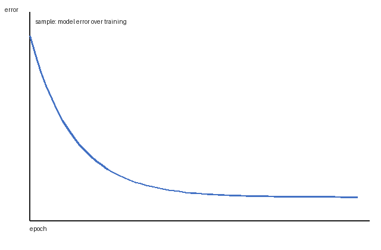

---
# ---------------------------------------------------------------------------
# Canonical example manuscript for the lnns-paper-format skill.
# Authors, ORCIDs, e-mails and all numeric results below are FICTIONAL
# placeholders that only exercise every feature of build_paper.py.
# The references are real publications, but verify every one before reuse.
# Copy this file, then replace everything.
# ---------------------------------------------------------------------------
title: "Drift-Aware Reweighting of Gradient-Boosted Ensembles for Tabular Process Data"
running_title: "Drift-Aware Reweighting of Boosted Ensembles"   # optional: only if the title is too long for the running head

# Conference settings (from the call for papers). They only drive check_paper.py.
conference:
  name: "Example International Conference on Intelligent Systems 2027"
  min_pages: 4
  max_pages: 12          # limit set by the organisers, references included
citation_order: citation  # citation | alphabetical -- how the reference list is ordered

authors:
  - given: Ivan
    family: Petrenko
    affiliations: [1]
    orcid: "0000-0000-0000-0000"
    email: "i.petrenko@example.com"
    corresponding: true
  - given: Olena
    family: Kovalenko
    affiliations: [1, 2]
    orcid: "0000-0000-0000-0001"
    email: "o.kovalenko@example.com"

affiliations:
  - "National Technical University of Ukraine “Igor Sikorsky Kyiv Polytechnic Institute”, Beresteiskyi Ave. 37, Kyiv 03056, Ukraine"
  - organization: "Example Research Institute"
    city: "Kyiv"
    country: "Ukraine"

# 150-250 words, one unstructured paragraph, no citations.
abstract: >-
  Gradient-boosted decision trees remain the strongest baseline for tabular industrial data, yet their
  accuracy degrades when the statistical properties of a technological process drift between the
  training period and operation. Retraining from scratch is expensive and discards useful history,
  while sliding windows react slowly to abrupt changes of the process regime. This paper proposes a
  drift-aware reweighting scheme that keeps a boosted ensemble accurate without full retraining. A
  density-ratio classifier separates recent records from historical ones, its scores are converted into
  bounded sample weights, and a small number of trees is fitted to the reweighted residuals of the
  existing ensemble. An update is accepted only if it lowers the validation error on recent data, so
  the model never becomes worse than before the update. The scheme is evaluated on a simulated
  heat-exchanger process with injected gradual and abrupt drifts and compared with periodic retraining
  and a sliding window under identical hyper-parameters. After an abrupt drift, the reweighted ensemble
  reduced the mean absolute error by roughly a quarter relative to the sliding window, while adding an
  order of magnitude fewer trees than periodic retraining; under gradual drift both adaptive strategies
  performed similarly. Drift-aware reweighting is therefore a cheap way to extend the useful life of
  boosted models in adaptive control loops, especially on embedded controllers with limited memory and
  computing resources.

keywords: [Concept Drift, Gradient Boosting, Importance Weighting, Tabular Data, Adaptive Control]

acknowledgments: "This study was funded by the Ministry of Education and Science of Ukraine (grant number 0000-placeholder)."
disclosure: "The authors have no competing interests to declare that are relevant to the content of this article."
# ai_disclosure: "The language of Sections 1 and 5 was edited with the assistance of artificial intelligence (AI) using <tool> developed by <organisation> (<version>, <month> <year>). The generated content was carefully reviewed, verified, and endorsed by the authors."

# splncs04 style (see references/reference-style.md), WITHOUT numbers, in the order given by citation_order.
references:
  - "LeCun, Y., Bengio, Y., Hinton, G.: Deep learning. Nature **521**(7553), 436–444 (2015). https://doi.org/10.1038/nature14539"
  - "Breiman, L.: Random forests. Mach. Learn. **45**(1), 5–32 (2001). https://doi.org/10.1023/A:1010933404324"
  - "Chen, T., Guestrin, C.: XGBoost: a scalable tree boosting system. In: Proceedings of the 22nd ACM SIGKDD International Conference on Knowledge Discovery and Data Mining, pp. 785–794. ACM, New York (2016). https://doi.org/10.1145/2939672.2939785"
  - "Ke, G., et al.: LightGBM: a highly efficient gradient boosting decision tree. In: Advances in Neural Information Processing Systems, vol. 30, pp. 3146–3154. Curran Associates, Red Hook (2017)"
  - "Shwartz-Ziv, R., Armon, A.: Tabular data: deep learning is not all you need. Inf. Fusion **81**, 84–90 (2022). https://doi.org/10.1016/j.inffus.2021.11.011"
  - "Grinsztajn, L., Oyallon, E., Varoquaux, G.: Why do tree-based models still outperform deep learning on typical tabular data? In: Advances in Neural Information Processing Systems, vol. 35, pp. 507–520. Curran Associates, Red Hook (2022)"
  - "Borisov, V., Leemann, T., Seßler, K., Haug, J., Pawelczyk, M., Kasneci, G.: Deep neural networks and tabular data: a survey. IEEE Trans. Neural Netw. Learn. Syst. **35**(6), 7499–7519 (2024). https://doi.org/10.1109/TNNLS.2022.3229161"
  - "Gama, J., Žliobaitė, I., Bifet, A., Pechenizkiy, M., Bouchachia, A.: A survey on concept drift adaptation. ACM Comput. Surv. **46**(4), 44:1–44:37 (2014). https://doi.org/10.1145/2523813"
  - "Lu, J., Liu, A., Dong, F., Gu, F., Gama, J., Zhang, G.: Learning under concept drift: a review. IEEE Trans. Knowl. Data Eng. **31**(12), 2346–2363 (2019). https://doi.org/10.1109/TKDE.2018.2876857"
  - "Webb, G.I., Hyde, R., Cao, H., Nguyen, H.L., Petitjean, F.: Characterizing concept drift. Data Min. Knowl. Disc. **30**(4), 964–994 (2016). https://doi.org/10.1007/s10618-015-0448-4"
  - "Sugiyama, M., Krauledat, M., Müller, K.-R.: Covariate shift adaptation by importance weighted cross validation. J. Mach. Learn. Res. **8**, 985–1005 (2007)"
  - "Lundberg, S.M., Lee, S.-I.: A unified approach to interpreting model predictions. In: Advances in Neural Information Processing Systems, vol. 30, pp. 4765–4774. Curran Associates, Red Hook (2017)"
  - "Pedregosa, F., et al.: Scikit-learn: machine learning in Python. J. Mach. Learn. Res. **12**, 2825–2830 (2011)"
---

# Introduction

Data-driven models are increasingly embedded in adaptive control loops, where they predict quality
indicators or equipment states from tabular sensor records [1]. For such data, ensembles of decision
trees [2] and, above all, gradient-boosted trees [3, 4] remain the most reliable choice: recent
benchmarks show that they still match or outperform deep architectures on typical tabular problems
[5–7].

A boosted model, however, is trained on a fixed historical window. When the technological process
changes regime, the joint distribution of inputs and targets drifts and the model degrades [8].
Full retraining discards the knowledge accumulated before the drift, while recency-based windows
need time to fill with post-drift data.

The aim of this work is to develop and evaluate a drift-aware reweighting scheme that updates an
existing boosted ensemble with a small number of additional trees and keeps its error bounded under
both gradual and abrupt drift. Section 2 reviews related work, Sect. 3 describes the method, Sect. 4
reports the experiments, and Sect. 5 concludes the paper.

# Related Work

Concept drift is commonly classified by its speed and extent into gradual, abrupt, incremental and
recurring drift [9, 10]. Adaptation strategies either detect drift explicitly and retrain, or adapt
continuously by forgetting old data. Importance weighting, originally proposed for covariate shift
[11], corrects the training distribution towards the target distribution without discarding data.
Attribution methods [12] explain which features are affected by drift but do not restore accuracy on
their own.

# Proposed Method

## Density-Ratio Weights

Let $D_h$ be the historical training window and $D_r$ the most recent window of $m$ labelled
records. A probabilistic classifier $c(x)$ is trained to separate $D_r$ (label 1) from $D_h$
(label 0); its output gives the density-ratio estimate

$$ \hat{r}(x) = \frac{|D_h|}{|D_r|} \cdot \frac{c(x)}{1 - c(x)} , $$

where $\hat{r}(x)$ is the estimated ratio of the recent to the historical input density. The ratio is
clipped to obtain bounded sample weights

$$ w_i = \min\left(\max\left(\hat{r}(x_i), w_{\min}\right), w_{\max}\right) , $$

where $w_{\min}$ and $w_{\max}$ limit the influence of any single record.

## Update Procedure

The update is performed in three steps:

1. compute the weights $w_i$ for the records of $D_h \cup D_r$;
2. fit $k$ new trees to the weighted residuals of the current ensemble;
3. accept the update if the validation error on $D_r$ decreases, otherwise keep the old ensemble.

### Acceptance Test

The acceptance test guarantees that an update never increases the error on recent data, so a false
drift alarm costs only the time spent fitting $k$ trees.

# Experimental Evaluation

The evaluation uses a simulated heat-exchanger process with 12 sensor features and two injected drift
scenarios: a gradual drift of the fouling coefficient over 5000 records and an abrupt change of the
inlet temperature regime at record 10000. The proposed method is compared with periodic full
retraining every 2000 records and with a sliding window of the last 4000 records. All models are
implemented with scikit-learn [13] and share the hyper-parameters listed in Table 1.

Table: Hyper-parameters shared by all compared models

| Parameter                 | Value |
|---------------------------|-------|
| Learning rate             | 0.05  |
| Maximum tree depth        | 6     |
| Initial number of trees   | 400   |
| Trees added per update, k | 20    |
| Weight bounds             | 0.2–5 |

Figure 1 shows the validation error of the reweighted ensemble during the initial training. The error
stabilises after about one hundred boosting rounds, which justifies the small number $k$ of trees added
per update.

{width=10cm alt="Line chart: validation error falls steeply during the first 100 boosting rounds and then flattens."}

After the abrupt drift, the reweighted ensemble reduced the mean absolute error by approximately 25 %
compared with the sliding window, while periodic retraining reached a similar error only after its
next scheduled retraining. Under gradual drift, the sliding window and the reweighted ensemble
performed similarly, which agrees with the expectation that slow drift is tracked well by any
recency-based scheme.

# Conclusion

The paper proposed a drift-aware reweighting scheme for gradient-boosted ensembles. Unlike periodic
retraining, it keeps the model history and adds an order of magnitude fewer trees; unlike a sliding
window, it reacts to an abrupt regime change within a few hundred records. The acceptance test makes
every update safe. Future work will address multivariate drift localisation and online selection of
the weight bounds.
