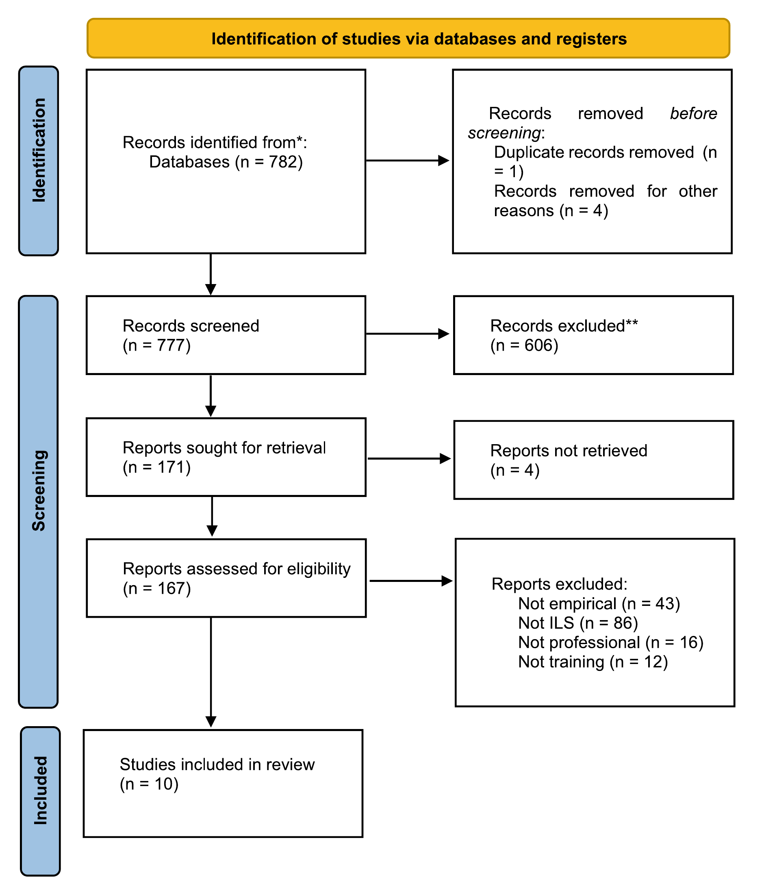

---
# ---------------------------------------------------------------------------
# REAL example for the lnns-paper-format skill: a published, open-access LNNS
# chapter converted to paper.md. See README.md in this folder for source,
# licence (CC BY 4.0) and the list of changes. Content is by the original
# authors (Odeen et al.); nothing here is invented.
# ---------------------------------------------------------------------------
title: "Intelligent Learning Systems for Simulator-Based Professional Training: A Systematic Literature Review"
running_title: "Intelligent Learning Systems for Simulator-Based Professional Training"

# The chapter does not state a page limit. Name only, so that check_paper.py can still report a page count.
conference:
  name: "MIS4TEL 2024 (ETELT 2024 workshop), LNNS 1274"
citation_order: citation

authors:
  - given: Martina
    family: Odéen
    affiliations: [1]
  - given: Charlott
    family: Sellberg
    affiliations: [2]
  - given: Gesa
    family: Praetorius
    affiliations: [1, 3]
    email: "gesa.praetorius@vti.se"
    corresponding: true
  - given: Oskar
    family: Lindwall
    affiliations: [2]
  - given: Linn
    family: Englund
    affiliations: [1]
  - given: Anders
    family: Andersson
    affiliations: [1]

affiliations:
  - "The Swedish National Road and Transport Research Institute (VTI), Regnbågsgatan 1, 417 55 Gothenburg, Sweden"
  - "University of Gothenburg, Forskningsgången 6, 417 56 Gothenburg, Sweden"
  - "University of South-Eastern Norway, Post Office Box 4, 43199 Borre, Norway"

abstract: >-
  This article presents the results of a systematic literature review on the use of Intelligent Learning
  Systems (ILS) in simulator-based professional education contexts aiming to provide guidelines on how
  to design a personalized, flexible, and adaptive learning experience to be used in remote simulator
  training for maritime cadets. The PRISMA protocol was employed to identify empirical studies
  published in international academic journals between 2018–2023. In the first step, 782 records were
  identified through searching through Scopus and Web of Science. After screening abstracts and full
  texts, a total of 10 studies remained. The article synthesizes results from three different domains
  where ILS have been used for simulator-based professional training: social science education,
  healthcare, and transportation. The results show a wide variety of applications and approaches to ILS
  design, such as to enhancing motivation and satisfaction in the students’ learning process through
  adaptive feedback, or to provide real-time evaluations and feedback to trainees. The review shows the
  importance of considering end-user groups and how these may make use of the system in the design of an
  ILS. While systems can offer modules to both instructor and trainee, it is important to recognize that
  the two are different in terms of what is needed to facilitate an effective, efficient, and
  learner-centered training path.

keywords: [Intelligent Learning System (ILS), Professional education and training, User-centered design]

acknowledgments: "This research is funded by the European Union’s Horizon Europe research and innovation programme under grant agreement No 101060107."

references:
  - "Wiig, A.C., Sellberg, C., Solberg, M.: Reviewing simulator-based training and assessment in maritime education: a topic modelling approach for tracing conceptual developments. WMU J. Marit. Aff. **22**(2), 143–164 (2023)"
  - "Kim, T.E., et al.: The continuum of simulator-based maritime training and education. WMU J. Marit. Aff. **20**(2), 135–150 (2021)"
  - "Gyldensten, W., Wiig, A.C., Sellberg, C.: Maritime students’ use and perspectives of cloud-based desktop simulators: CSCL and implications for educational design. TransNav: Int. J. Marine Navig. Safety Sea Transport. **17** (2023)"
  - "Desmarais, M.C., d Baker, R.S.: A review of recent advances in learner and skill modeling in intelligent learning environments. User Model. User-Adap. Inter. **22**(1), 9–38 (2012)"
  - "Deliyska, B., Manoilov, P.: Ontologies in intelligent learning systems. In: Intelligent Learning Systems and Advancements in Computer-Aided Instruction: Emerging Studies, pp. 31–48. IGI Global (2012)"
  - "Moher, D., et al.: Preferred reporting items for systematic review and meta-analysis protocols (PRISMA-P) 2015 statement. Syst. Rev. **4**(1), 1–9 (2015)"
  - "Shen, C., Qi, A.: An adaptive learning mode of “public psychology” based on creative thinking with virtual simulation technology. Int. J. Emerg. Technol. Learn. **15**(23), 131–144 (2020)"
  - "Becerra-Alonso, D., Lopez-Cobo, I., Gómez-Rey, P., Fernández-Navarro, F., Barbera, E.: EduZinc: a tool for the creation and assessment of student learning activities in complex open, online, and flexible learning environments. Distance Educ. **41**(1), 86–105 (2020)"
  - "Buzady, Z., Wimmer, A., Csesznak, A., Szentesi, P.: Exploring flow-promoting management and leadership skills via serious gaming. Interact. Learn. Environ. 1–15 (2022)"
  - "Johnson, W.L.: Data-driven development and evaluation of Enskill English. Int. J. Artif. Intell. Educ. **29**(3), 425–457 (2019)"
  - "Dell’Aquila, E., Vallone, F., Zurlo, M.C., Marocco, D.: SG-ACCORD: designing virtual agents for soft skills training in the school context. Education Sciences **12**(3), 174 (2022)"
  - "Sun, Z., Theussen, A.: Assessing negotiation skill and its development in an online collaborative simulation game: a social network analysis study. British J. Educ. Technol. (2022)"
  - "Ropelato, S., Menozzi, M., Michel, D., Siegrist, M.: Augmented reality microsurgery: a tool for training micromanipulations in ophthalmic surgery using augmented reality. Simul. Healthcare **15**(2), 122–127 (2020)"
  - "Vannaprathip, N., Haddawy, P., Schultheis, H., Suebnukarn, S.: Intelligent tutoring for surgical decision making: a planning-based approach. Int. J. Artif. Intell. Educ. **32**(2), 350–381 (2022)"
  - "Guchenko, M., Shmakov, V., Yudina, A., Belska, V., Cejka, J., Bartuska, L.: An approach to developing mathematical software of on-board helicopter flight simulator decision support system. LOGI–Sci. J. Transp. Logist. **13**(1), 61–72 (2022)"
  - "Hong, Z., Chen, Y., Wu, Y.: A driver behavior assessment and recommendation system for connected vehicles to produce safer driving environments through a “follow the leader” approach. Accid. Anal. Prev. **139**, 105460 (2020)"
  - "Atkinson, R.C., Wilson, H.A.: Computer-assisted instruction. Science **162**(3849), 73–77 (1968)"
  - "Nwana, H.S.: Intelligent tutoring systems: an overview. Artif. Intell. Rev. **4**(4), 251–277 (1990)"
  - "Chen, N.S., Cheng, I., Chew, S.W.: Evolution is not enough: Revolutionizing current learning environments to smart learning environments. Int. J. Artif. Intell. Educ. **26**(2), 561–581 (2016)"
  - "Fardinpour, A., Pedram, M.M., Burkle, M.: Intelligent learning management systems: definition, features and measurement of intelligence. Int. J. Distan. Educ. Technol. **12**(4), 19–31 (2014)"
  - "Esichaikul, V., Lamnoi, S., Bechter, C.: Student modelling in adaptive e-learning systems. Knowl. Manage. E-Learn. Int. J. **3**(3), 342–355 (2011)"
  - "Shemshack, A., Spector, J.M.: A systematic literature review of personalized learning terms. Smart Learn. Environ. **7**(1), 1–20 (2020)"
  - "Tang, Y., Liang, J., Hare, R., Wang, F.Y.: A personalized learning system for parallel intelligent education. IEEE Trans. Comput. Soc. Syst. **7**(2), 352–361 (2020)"
  - "Tacoma, S., Drijvers, P., Jeuring, J.: Combined inner and outer loop feedback in an intelligent tutoring system for statistics in higher education. J. Comput. Assist. Learn. **37**(2), 319–332 (2021)"
---

# Introduction

In maritime education and training (MET), exercises in simulated environments play a central role for educating the future maritime workforce [1]. Recent advances in simulator technology offer opportunities for students to participate in remote training using cloud simulations [2]. However, a limitation of remote simulation training is that students typically do not receive personalized instruction, nor personalized feedback, and struggle to find the generic feedback from the system meaningful [3]. With the current advancements in training technologies, integrating Intelligent Learning Systems (ILS) with remote simulator training may provide new ways of addressing this problem, offering personalized feedback to students to help them learn in a meaningful and effective manner [4]. Within this study, the ILS is understood in accordance with [5] as a “fully adaptive, personalized e-learning system without human teacher participation”.

This study explores how ILSs have been integrated in simulator-based training in professional education by conducting a systematic literature review [6]. The review was designed to explore current developments of ILS that have been empirically tested in educational settings and focused on empirical studies published between 2018 and 2023 across a variety of settings where professional learning is in focus. With the aim to provide recommendations for the design of an ILS for MET, including guidance on how to develop a personalized, flexible, and adaptive learning experience in simulator-based maritime education, the following research questions guided the review: a) what kind of ILS designs have been developed for simulator-based professional training? b) what kind of learning theories guided these studies? c) how can lessons learned in other settings guide the development of an ILS for maritime simulator-based professional training?

# Methodology

The systematic review method adopted in this study follows the Preferred Reporting Items for Systematic Reviews and Meta-Analyses [6]. The literature search was conducted in Scopus and Web of Science by the second author in October 2022, using a search string designed to include various notions of ILS and ILS platforms in the context of simulator-based training (Table 1). To focus the review on current advances in ILS research, the search for articles was limited to empirical studies published between 2018–2023 and filtered to highlight highly cited articles and popular topics in Web of Science. By only including articles in gold, silver, and bronze journals in Scopus, the study was limited to peer-reviewed articles in high-quality journals. Additionally, the search was focused on articles published in English to ensure relevance and transparency for an international audience.

Table: Search string

| intelligent OR smart OR adaptive OR personalized |
|---|
| AND learn* OR train* OR assess* OR tutor* |
| AND system* OR platform* OR environment |
| AND simul* |

The process of the screening, data collection and data items are illustrated in Fig. 1. As a result of the searches in Scopus and Web of Science, 782 articles were identified. The searches were saved in spreadsheets, containing information on bibliographic metadata and the abstract. Before screening, duplicates were removed (n = 1) as well as review articles found in the dataset (n = 4). Following this step, 777 abstracts were screened in a process where five of the six authors participated. Each abstract was read by at least two authors.

The inclusion criteria for articles were the following:

- the article presents empirical findings from the design and usage of an ILS,
- the ILS was designed and/or used within the setting of professional education and training,
- the focus of the article is not on the development of the algorithms within the system, but on how the system was actually used in practice.

At this stage, 606 records were excluded that did not meet the inclusion criteria; for example, by lacking a focus on a digitalized ILS, lacking a focus on professional education, or lacking an empirical foundation for the results presented. Data items for the remaining articles, in terms of the name of the study, year, authors, aim, method, intelligent learning systems, human performance measures, results, and discussion points, were summarized in a table. Next, 171 full texts were sought for retrieval. In this step, 4 articles could not be retrieved from the databases available through the university and were left out of the review. Hence, 167 full texts were assessed for eligibility by the first and second authors.

{width=8cm alt="PRISMA flow diagram. 782 records were identified from databases; 777 were screened after 1 duplicate and 4 other records were removed; 606 were excluded; 171 reports were sought and 4 not retrieved; 167 were assessed for eligibility and 157 excluded (43 not empirical, 86 not ILS, 16 not professional, 12 not training); 10 studies were included."}

In the last step, all articles not reporting empirical results, not being focused on professional education, i.e. studies within university settings or secondary schools were excluded, not containing an actual ILS, nor focusing on training were excluded. Only ten studies meeting our inclusion criteria remained.

# Results

The review identified three domains in which ILS were used for professional training: Social science education (Sect. 3.1, n = 5), Healthcare (Sect. 3.2, n = 3), and Transportation (Sect. 3.3, n = 2).

## Social Sciences Professional Education: Virtual Platforms, Automated Feedback, and Learning Analytics

Five studies report findings related to the use of ILS for professional education in the social sciences, including educational fields such as teacher training, psychology, and political science, where virtual learning environments have been combined with adaptive learning functions [8–11]. These studies mainly investigate ILS as a way of improving student motivation, satisfaction, and learning performance.

[9] developed an intelligent tutoring tool named EduZinc for the creation and assessment of student learning activities in complex open, online, and flexible learning environments. EduZing makes it possible for tutors to both create and assess course activities and materials. The tool can be used to create individualized learning products, such as activities and exams, automatically grade tests, create student, class, and competency-based reports, and deliver the reports to students, instructors, and tutors. An example of a more specialized platform is Enskill, a data-driven tool tailored for teaching English as a second language (L2 education) [10]. The Enskill prototype supports simulated exercises by evaluating content comprehension, pronunciation accuracy, and student responses, while also providing insights into exercise completion time, utterance duration, and conversational interactions. Both forms of feedback exhibited positive impacts on student satisfaction and learning outcomes; the former was found to enhance feedback quality, and the latter effectively evaluated student progress during dialogues [9]. In another study,[11] designed a serious game for training and assessing skills involved in classroom management, with a focus on non-technical skills such as negotiation, effective communication, and intercultural conflict management. The game is called “Attain Cultural Integration through Conflict Resolution Skill Development” (SG-ACCORD) and is a single-player virtual role-play, offering a series of scenarios reflecting the working life experiences of teachers. The interactions unfold between a player-controlled avatar (the teacher) and a computer-controlled counterpart (the student). SG-ACCORD’s design aims to provide a user-friendly, adaptable educational resource that can stand alone, complete with automated feedback mechanisms and tools for post-simulation debriefing [11]. They [11] highlight how the systems log of interaction can facilitate teachers’ retrospective self-reflections on the dynamics during the simulated activities. These reflections, it is argued, hold the potential to enhance teachers’ conflict resolution skills.

Alternative methods involve the incorporation of adaptive features within existing frameworks. In [8] the authors illustrate this by integrating the programming software Scratch into a simulator system utilized for psychology education. The adaptive functions allow for managing the teaching software, monitoring psychological experimental processes as well as analysis of the students’ work with psychological experiments. Another approach to automated feedback is to use learning analytics methods to assess skills in simulated environments [9, 12]. [12] explore the process of training negotiation skills in a collaborative simulation game used in a political science course. In this study, temporal social network analysis is used as a tool for understanding the students’ learning trajectories over time and identifying the key moments when they need instructional support. [8] leverage learning analytics to scrutinize the correlations among 29 leadership skills, player strengths, and the flow experienced by participants during gameplay in a simulation named Fligby, designed to emulate leadership decision-making. Although Fligby does not offer direct automated feedback to players, it capitalizes on game-based psychometrics to furnish intricate insights into the interplay between players and the game.

## Healthcare: Virtual Reality, Augmented Reality, and Conversational Agents

In healthcare education, ILSs have been introduced as a component in simulation-based surgical training. As noted by [13] and [14], there is a large and growing body of research studies showing the value of simulations for surgical training. Many simulation-based learning environments deliver feedback to the users, e.g., the amount of tissue damage, but according to [14], few simulators include any intelligent tutoring component. Ropelato et al. developed a custom-built system for the training of micromanipulation skills in Ophthalmic Surgery. The system consists of two parts: a) a virtual training environment enabled by an Augmented Reality (AR) headset (Microsoft Hololens) that visualizes the scenario and tracks the relevant micromanipulations; and b) a component that controls the administration of training tasks based on the performance of the users. The trainees interact with the system by using a microsurgical handle while observing a 3D holographic representation of the human eye and instrument position through the AR headset. The system continuously measures the performance of the trainees by logging the deviation from an optimal path. Five subtasks corresponding to different surgical procedures were developed, where each subtask could be offered with various levels of difficulty. The intelligent tutoring system was designed to continually match the difficulty level of the subtasks with the measured performance level, thereby offering the trainees tasks of appropriate challenge. By comparing the performance of a group of users that had the subtasks administered in sequential order with a group for whom the tasks were administrated by the intelligent tutoring system, the study shows that the ILS improves the overall results. With reference to Gallagher et al. (2012), the authors also raise the importance of objective, clear and complete metrics, such as the deviation from an optimal path in microsurgery.

As noted by [14] most surgical simulators are designed to train technical skills, such as micromanipulation techniques, and not non-technical skills like teamwork, communication skills and decision-making. Addressing this gap in research and development, [14] introduce what they call the first intelligent tutoring system for teaching surgical decision-making. Like the simulation investigated by [13], the system can be divided into two main comments: a) a virtual reality simulation consisting of a head-mounted display and haptic devices; and b) a conversational intelligent tutoring system called SDMentor (Surgical Decision-making Mentor). The system uses a standard intelligent learning system-framework including a domain model, student model, pedagogical module, and user interface. For the design of the domain model and pedagogical module, observational data of interaction between dental instructors and students were collected and analyzed with a focus on teaching strategies (e.g., asking questions, providing information, and giving feedback) and knowledge representation requirements (e.g., the effects of the performed actions). To evaluate the quality of the tutoring system, [14] compared it with tutorial feedback from experienced human tutors. The results showed that SDMentor was significantly better at providing tutoring interventions.

## Transportation: Decision Support and Recommendation Systems

Two empirical studies using ILS approaches in the transportation domain were identified [15, 16]. [15] explore the use of mathematical modelling to develop an intelligent decision support and feedback system (IDSS) to enhance and improve helicopter simulator training, an “electronic instructor”. The electronic instructor monitors the flight performance during the simulation and provides real time feedback enabling trainees to correct potential errors. The system aims to complement current simulation training approaches, which normally require feedback from instructors. As the IDSS is developed based on a mathematical model of the helicopters’ flight dynamics and maneuverability, the system can both support and substitute the instructor during simulation exercises. The IDSS in the study is based on an expert system approach mimicking the pilot decision making at reference points to predict optimal control actions. Based on the prediction, deviations by trainees can be evaluated and appropriate instructions concerning flight paths, speed and altitude can be suggested. The authors argue that helicopter pilot training is mostly conducted in simulators, which makes it important to adapt instructional methods that can provide feedback that does not only correspond to what happens in the simulated world, but that corresponds to naturalistic flight environments and conditions.

[16] built a conceptual framework for driving assessment and recommendation systems to evaluate driving performance and guide driving behaviors with the aim to improve the network traffic conditions and drivers’ perceived safety. Data mining techniques were used to extract, identify, characterize, and display driving behavior patterns. The pattern recognition system extracted information from raw data by identifying behavioral features such as lane changes, turns, harsh brakes etcetera. A Gaussian Mixture Model-Universal Background Model was then used to detect background factors from information of each driver in the dataset. At the same time an individual driving model for each driver is constructed to characterize an individual behavior profile. A comparison was then made between a driver’s individual pattern and a standard “safe driver” pattern, which created a safety score. The scoring system was implemented in the drivers’ cars and worked as a basis for assessing individual drivers, who were then recommended to mimic a nearby “safe” driver in a connected environment [16]. From the results it was shown that the proposed framework for behavior assessment and recommendation system confirmed the capability to provide accurate detection, safety score calculation, and driving behavior characterization [16].

# Summary of Findings

The findings of this review show that ILS as concept is currently still under development and can describe a wide range of different systems with different objectives and varying user groups. It is also noteworthy that only 10 out of a total number of 777 abstracts included in this study focused on empirical findings concerning the application of ILS in professional learning settings.

Synthesized from prior studies, prevailing learning models within the educational realm revolve around motivation, satisfaction, and active engagement [7–9]. The adaptive nature of ILS, grounded in the assimilation of student performance data, facilitates personalized guidance and real-time task difficulty adjustments to align with the learner’s current knowledge level. This adaptability augments motivation and satisfaction for learners during task execution, bolstered by system-initiated notifications of task mastery [8] and tailored assistance during periods of challenge [12]. Active learning is palpable as students engage in reflective practices and respond to task-related inquiries during the process. The integration or fusion of ILS with virtual environments or software renders learning accessible and flexible, enabling students to complete assignments irrespective of their location or schedule. This feature is identified as a motivational attribute, enhancing the system’s appeal [7, 8].

In the healthcare domain, active and tactile learning emerged as central models. These models were actualized using technologies such as virtual reality head-mounted displays [14] and augmented reality via tools like Hololens 2 and surgical instruments [13]. Within such setups, students engaged in hands-on practice of surgical techniques, and in instances like [14], were granted dedicated time for introspection after each subtask. The acquisition of input data for the Interactive Learning Systems (ILS) was multifaceted. For instance, [13] employed USB cameras and trainee-manipulated components on surgical instruments, while [14] captured cinematic data of the trainee’s actions through virtual reality equipment. This real-time tracking and logging of trainees’ surgical skills and decision-making furnished a wealth of information, empowering the ILS to provide instant adaptive feedback, whether during or post-training. This feedback encompassed instructions, guidance, task adaptation, and scoring adjustments, thereby enhancing the overall training experience.

Within the realm of transportation, ILS took on the roles of electronic instructors and recommendation systems. In this context, the ILS offered immediate adaptive feedback to steer trainees in their driving or flying endeavors [15, 16]. Given the inherent risks tied to driving and flying tasks, particularly the potential for accidents resulting from lapses in concentration, the application of active learning deviated from the patterns observed in prior domains. In the domains of education and healthcare, students had time to reflect and answer questions, while students in the transport domain instead followed instructions and safe error correction by the ILS based on their driving performance. In the study of helicopter flight training, data used to provide input to the ILS were flight parameters of a flight dynamic model representing the helicopter, as well as the trainee pilot’s maneuvers and how well these corresponded to a desired move [15]. For car driving training, the input to the ILS was drawn from information extraction from the behavioral features of the driver, such as lane changes, harsh brakes, and turns [16].

# Discussion

The history of ILS can be traced back to earlier work on computer-assisted instruction (e.g., [17]) and intelligent tutoring systems [18]. More recently, notions such as smart learning environments [19], intelligent learning management systems [20], adaptive learning systems (e.g. [21]), and personalized learning systems (e.g., [22]) have been introduced. Attempts to establish a common definition of ILS [19, p. 19] have been complicated by its complex history. Personalized and adaptive learning systems have been a topic for a long time [23] and incorporate knowledge and approaches across various research fields and disciplines, including computer science, psychology, and education [18]. It might therefore be hard to reach a consensus on central issues, such as which tools and features make a learning system intelligent and fit for specific purposes [20]. This lack of consensus is seen also in the results for this review, highlighting the diverse applications of Intelligent Learning Systems (ILS) within professional education across various domains. These applications range from tutoring systems for trainees to decision support systems aiding instructors in assessment. It is noteworthy that none of the studies presented findings from combining a tutoring and assessment functions, which may hint about the difficulty to design for multiple user groups at the same time as needs might be too diverse. As mentioned above, only 10 out of the 777 studies included empirical data about either the utilization of an ILS or evaluation. This shows that while there is a wide interest and range of publications, but many of these are on a conceptual or technical basis not actually addressing end-users and empirical findings from real-life settings.

Furthermore, as noted in the included studies, only one of the articles [9] utilized a pedagogical approach, i.e., the concept of flow to design the user interaction with the system. The other articles did either not explicitly mentioned any pedagogical approach or did not explicitly consider learners’ perceptions and motivation in their system design approach. Additionally, many of the studies, such as [15] or [16] focused on offering feedback on specific metrics for isolated tasks or isolated situations, i.e. not considering learning advances over time. While this might be useful feedback on trainee performance during a single simulation and for the sake of assessment, it may not be what triggers learning and skill improvement, and may also explain the lack of reported research on achieving broader learning goals and outcomes. Questions persist regarding how system feedback contributes to increased performance at a higher level and how it aligns with learning goals and outcomes. The literature lacks clear answers on how performance pathways can be designed to allow learners to progress in multiple ways, especially in complex task environments like the maritime domain, where numerous potential actions may be possible in each situation. Clarifying these aspects remains a priority for future research in this field.

## Limitations

The scope of the databases employed to find articles pertaining to Interactive Learning Systems (ILS) for simulator-based training was confined to Web of Science and Scopus. The adoption of additional databases might have yielded a more extensive array of articles, thereby potentially enriching the ensuing analysis. Moreover, by focusing solely on simulator-based training within professional education contexts, several potentially interesting studies were omitted. A case in point is the work of [24], which examined the efficacy of different feedback loops in an ILS. The integration of inner and outer loop feedback exhibited positive outcomes on student learning, prompting their inclusion in computer-based learning environments. Yet, [24] astutely points out that most preceding studies focused solely on one feedback type, thus failing to replicate the multifaceted feedback dynamic encountered in real-world teaching scenarios.

Another interesting point for discussion is the limitations of the results of the studies included in the review. Although most studies reported positive results of implementing an ILS in professional learning environments related to creative thinking, collaboration, and communication, as well as academic performance as a result of immediate feedback from the system [7, 8], several studies also reported limitations with the results in terms of internal and external validity. For example, in the studies of [8] and [14] the ILS were only tested for a short period of time, meaning that the improvement of the students’ performance could not be determined with certainty whether the improvement was a consequence of using the tool or if other teaching related aspects were involved. Similarly, in the study of [13] the ILS was only tested on a specific surgical task, making it difficult to evaluate how well the system improves the student performance in other similar surgical tasks.

# Conclusions and Implications

The published literature with empirical findings on the usage of ILS is up to now sparse. However, several important implications for the design of ILS in professional simulator-based education can be identified.

The end-users for the system need to be clearly identified early in the design process. Given that published literature only addresses either trainees or instructors as end-users indicates that the two groups may have different goals, motivations and information, as well as usability needs. These need to be thoroughly researched before the interaction and potential learning paths are identified and designed. Further, as simulator-based exercises within the maritime domain are conducted in groups, it is necessary to consider how to balance individual performance and group feedback. It is about both weighing what to assess and how to communicate this so that a learning experience including learning goals and learning achievements can be designed over time. While tailored solutions for groups are probably easier to achieve with regards to an incremental learning, it might be resource intensive and very complex to design learning paths for individual trainees embedded in groups during simulator exercises.

It is also important to consider the pace of feedback as well as how it is provided. ILSs reported about in this review almost exclusively focused on synchronous feedback instead of asynchronous feedback that triggers skill development over time. It indicates that there is a need for further research into learning paths and skill development within digital learning platforms. Furthermore, as learning is core to ILSs end-users, the system design should be built on solid pedagogical grounds to ensure that desired outcomes are achieved, not only in the short-term, but also in the long run. This may also include considerations on what type of data and information should be provided to ground the trainees’ learning experience.
